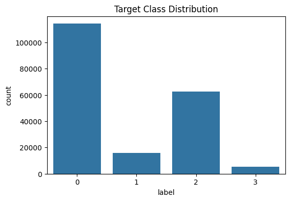
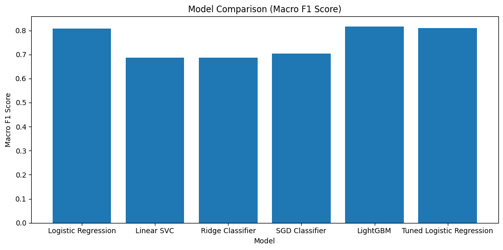

# Comment Category Prediction

Multi-class classification of user comments from an online discussion platform into one of four moderation categories, using the comment text together with engagement signals and system-generated metadata.

Built for the **Comment Category Prediction Challenge** (Kaggle, Jan–Mar 2026) as the course project for *Machine Learning Practice* in the IIT Madras BS in Data Science programme.

## Problem

| | |
|---|---|
| Task | 4-class classification (`label` ∈ {0, 1, 2, 3}) |
| Train / test size | 198,000 / 102,000 comments |
| Metric | Macro F1 (every class weighted equally) |
| Main difficulty | Heavy class imbalance: class 3 is only **2.8%** of the data |

Each row combines three kinds of features:

- **Text**: the raw comment
- **Numeric**: upvotes, downvotes, three emoticon counts and two hidden platform features (`if_1`, `if_2`)
- **Categorical**: identity-reference flags (`race`, `religion`, `gender`, `disability`), missing for ~73% of rows

<p align="center">
  
</p>

## Approach

**1. Exploratory analysis**: class balance, comment length and word count distributions, skew and outliers in the engagement features, correlations with the target.

**2. Preprocessing** (all inside a single scikit-learn `ColumnTransformer`, so the exact same steps run on train, validation and test with no leakage):

| Feature group | Steps |
|---|---|
| Comment text | TF-IDF on word n-grams (1–4) **plus** character n-grams (3–5), sublinear TF, English stop words |
| Skewed counts | `log1p` → `RobustScaler` |
| Other numeric | `RobustScaler` |
| Identity flags | Missing values filled with `"unknown"` and kept as their own category → one-hot encoding |

**3. Feature engineering**: engagement total, difference and ratio (`upvote / (downvote + 1)`).

**4. Outliers**: found with IQR but **kept**, since high engagement is real signal rather than noise. Log transforms and robust scaling handle the skew instead.

**5. Class imbalance**: custom class weights (`{0: 1, 1: 1.5, 2: 1, 3: 2.5}`) rather than resampling.

## Results

Hold-out validation set (20% stratified split):

| Model | Macro F1 |
|---|---|
| **LightGBM** | **0.817** |
| Logistic Regression (tuned with `RandomizedSearchCV`) | 0.809 |
| Logistic Regression | 0.807 |
| SGD Classifier (log loss) | 0.70 |
| Linear SVC | 0.688 |
| Ridge Classifier | 0.686 |

<p align="center">
  
</p>

The final Kaggle submission used tuned Logistic Regression with combined word and character TF-IDF features.

## Key takeaways

- **The features mattered more than the model.** With good TF-IDF features the data is close to linearly separable, so plain Logistic Regression came within 0.01 of LightGBM.
- **Combining word and character TF-IDF beat either one alone.** Character n-grams pick up misspellings, slang and obfuscated words that word tokens miss.
- **Macro F1 exposes the rare class.** Accuracy was ~0.91 for the best models, but class 3 F1 stayed around 0.6–0.64, so that is where the remaining headroom is.
- **Hyperparameter tuning gave small gains.** Most of the improvement came from preprocessing and feature engineering.

## Repository structure

```
.
├── notebooks/
│   └── comment_category_prediction.ipynb   # EDA → preprocessing → models → submission
├── assets/                                 # plots used in this README
├── requirements.txt
└── README.md
```

## Running it

The competition data can't be redistributed. To get it, join the competition on Kaggle, download `train.csv`, `test.csv` and `Sample.csv`, and update the paths in the *Data Loading* cell.

```bash
pip install -r requirements.txt
jupyter notebook notebooks/comment_category_prediction.ipynb
```
